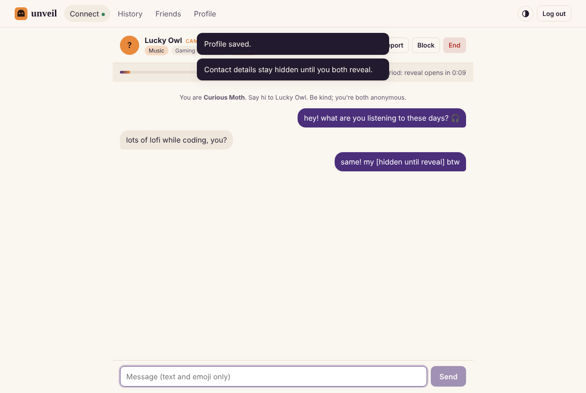

# Unveil

Anonymous, consent-first social networking for verified college students. Two students are matched for a one-to-one text chat without seeing each other's names or faces. Once both have stayed past a safe period, either can choose to reveal; identities are shown only when **both** do. After that they can become friends.

Built from the Team 08 SRS (20CYS401 Secure Software Engineering) with the stack it specifies: React, Node.js/Express, Socket.IO, PostgreSQL, Redis, JWT and bcrypt, plus a TensorFlow.js toxicity model for moderation.



## Run it

### With Docker (simplest)

```bash
cp .env.example .env      # fill in POSTGRES_PASSWORD, JWT_SECRET, CAPTCHA_SECRET, ADMIN_EMAIL, ADMIN_PASSWORD, SMTP_*
docker compose up --build -d
```

The app listens on 127.0.0.1:4000 for an HTTPS reverse proxy to forward to. The admin account comes from `ADMIN_EMAIL` / `ADMIN_PASSWORD`. To try it locally without an email server, add `NODE_ENV=development` to `.env`: sign-up codes then print in `docker compose logs -f app`, and the `@demo.edu` / `@sample.edu` test colleges are available.

### Without Docker

Needs Node 20 or 22 (TensorFlow for Node does not support newer releases yet), PostgreSQL 14+ and Redis 6+ running locally. `npm run install:all` also downloads the moderation model.

```bash
npm run install:all
createdb unveil                                   # or set DATABASE_URL
ADMIN_EMAIL=admin@unveil.local ADMIN_PASSWORD=AdminPass123 npm run setup
npm run dev:server                                # API + sockets on :4000
npm run dev:client                                # React app on :5173 (proxies to :4000)
```

Open http://localhost:5173. To try a full chat on one machine, use two browser profiles (or one normal and one private window) and sign up two students with `@demo.edu` addresses. Set `SAFE_PERIOD_SECONDS=20` when starting the server so you don't wait five minutes to test the reveal.

For production: `npm run build`, then `NODE_ENV=production npm start` serves the built React app and the API from one port. Put it behind HTTPS; cookies are `Secure` in production. All settings are listed in [`.env.example`](.env.example).

### Tests

```bash
createdb unveil_test
npm test
```

26 tests: moderation (against the real model), tokenizer and matchmaking units, plus API/socket integration tests that drive real Postgres and Redis through registration, OTP, password reset, account deletion, matching, chat, moderation, reveal, friends, reports, admin action, blocking, auto-suspension and message retention.

## Colleges

A student can only register with an email whose domain belongs to a college in the `colleges` table. The seed adds the Amrita campuses (`am.students.amrita.edu`, `cb.students.amrita.edu`, `bl.students.amrita.edu`) and two demo domains (`demo.edu`, `sample.edu`). Admins can add more from the dashboard.

## How it works

```
React (Vite) ──HTTPS/REST──▶ Express API ──▶ PostgreSQL (users, sessions, messages, reports, audit log)
      │                          │
      └──── WebSocket ─────▶ Socket.IO ──▶ Redis (matchmaking queue, lock, rate limits, CAPTCHA nonces)
```

| SRS class (Worksheet 3) | Where it lives |
|---|---|
| User / Student | `server/src/routes/auth.js`, `routes/me.js`, `routes/social.js` |
| Administrator | `server/src/routes/admin.js`, `client/src/pages/Admin.jsx` |
| MatchmakingEngine | `server/src/services/matchmaking.js` |
| ChatSession | `server/src/services/chat.js`, `server/src/socket.js` |
| AIModerationSystem | `server/src/services/moderation.js`, `server/src/services/toxicity.js` |
| Report / TrustScoreManager | `routes/social.js`, `services/trust.js` |

### Matching

Students pick **Campus Connect** (same college) or **Cross Campus** (different college), and match by **Interests**, **Personality** or **Mystery** (no filter). Waiting tickets sit in a Redis hash; a short Redis lock makes pairing atomic. Candidates must satisfy both people's filters, and are never anyone either person has blocked. The best candidate is chosen by shared tags, trust-score similarity, and how long they have waited.

### Anonymity and reveal

Each chat gets two random aliases (e.g. *Quiet Moth*). Before the reveal the partner sees only aliases, interests and personality tags; user ids never leave the server, and report, block and friend actions are addressed by chat id. Emails, phone numbers, links and social handles are masked automatically until the reveal. After `SAFE_PERIOD_SECONDS` either person can press **Reveal me**; the reveal happens in one atomic update once both have consented.

### Moderation and trust

Moderation uses a machine-learning model, not word lists. Every message is scored before it is delivered by a pretrained neural toxicity classifier: Google's TensorFlow.js toxicity model, a Universal Sentence Encoder (transformer) with seven heads trained on the Jigsaw *Civil Comments* dataset of human-labelled comments. It runs inside the Node server with `@tensorflow/tfjs-node` (about 50 ms per message on a laptop CPU), so messages never leave the server for moderation.

The model gives a probability for each label, and per-label thresholds in [`server/src/services/moderation.js`](server/src/services/moderation.js) decide the outcome:

| Model label | Low (delivered, logged) | Medium (blocked + warning) | High (blocked, chat ended) |
|---|---|---|---|
| threat | | ≥ 0.40 | ≥ 0.60 |
| severe_toxicity | | ≥ 0.30 | ≥ 0.50 |
| identity_attack (hate) | | ≥ 0.40 | ≥ 0.60 |
| sexual_explicit | ≥ 0.25 | ≥ 0.60 | |
| insult (harassment) | ≥ 0.60 | ≥ 0.90 | |
| toxicity | ≥ 0.70 | | |
| obscene | ≥ 0.60 | | |

Around the model:

- **Obfuscation:** leetspeak, stretched letters and spaced-out words (`k1ll y0uuu`, `s t u p i d`) are normalised and scored too; the worse reading counts.
- **Escalation:** a third borderline (low) rude or sexual message from the same person in one chat is treated as medium.
- **Spam:** the same message sent over and over is flagged from behaviour, not wording.
- **Privacy:** before the reveal, emails, phone numbers, links and social handles are masked.
- Every message's scores are stored, and admins see the model's strongest signal next to each line of a reported transcript.

Medium and high results raise an AI report for admins and lower the sender's trust score. Three warnings suspend the account automatically until an admin reinstates it.

The model files (~29 MB) are downloaded from Google's TensorFlow.js model storage and checked against pinned SHA-256 hashes by `npm run fetch-model`, which also runs automatically on `npm install`. The server refuses to start if the model cannot be loaded, so chat is never unmoderated. Known limits: the model is English-only and can miss politely worded harassment; reports and blocks cover those cases.

The trust score (0 to 100, starts at 50) is private. It goes up for conversations that last past the safe period, mutual reveals and accepted friend requests, and down for blocks, moderation hits and upheld reports. Students only see a coarse standing (excellent / good / fair / limited).

## Security controls (SRS §3.4)

| Requirement | Implementation |
|---|---|
| Passwords stored with bcrypt | bcrypt cost 12 (`routes/auth.js`) |
| JWT authentication | HS256 JWT in an `httpOnly`, `SameSite=Strict` cookie, `Secure` in production |
| WebSocket authentication | Socket.IO handshake verifies the same cookie; user status is re-checked on every action |
| Role-based access control | `requireRole('admin')` / `requireRole('student')`; admins cannot use chat |
| College verification | email domain must belong to a known college; 6-digit email OTP (hashed, 10-minute expiry, 5 attempts) |
| CAPTCHA at registration | HMAC-signed, expiring, single-use arithmetic CAPTCHA |
| Input validation (XSS, SQLi) | zod schemas on every endpoint and socket event; parameterised SQL only; React escapes output; strict CSP via helmet |
| Rate limiting | per-route limits on auth, global API limit, 8 messages per 5 s per user |
| Brute force | account locks for 15 minutes after 5 failed logins; constant-time comparison for unknown emails |
| CSRF | `SameSite=Strict` cookie plus a required `X-Requested-With` header on state-changing requests |
| Audit logging | logins (success, failure, lockout), registrations, reports, moderation blocks, admin actions (`audit_log` table, visible in the dashboard) |
| Identity hidden during chat | partner ids and profiles never sent before the mutual reveal; contact details masked |
| Media restrictions before reveal | text and emoji only; payloads capped at 1000 characters / 16 KB |

## Accounts and data

- Sign-up requires agreeing to the Terms and Privacy Policy (`/terms`, `/privacy`); the time of agreement is stored. **Both pages are drafts** written to match what the code does; have them reviewed and set the contact address in `client/src/pages/Legal.jsx` before launch.
- Forgotten passwords are reset with an emailed 6-digit code. The response never says whether an account exists.
- Students can delete their account from Profile. Their profile, messages, friends and blocks are erased; the user row stays as an anonymous placeholder so reports about them still work.
- An hourly job deletes chat messages older than `MESSAGE_RETENTION_DAYS` (default 30) unless an open report needs them, expired codes, and audit log entries older than a year.

## Before launch

Code-side items are done. These need someone with access to the real environment:

1. **Domain and HTTPS.** Run behind a TLS-terminating proxy; cookies are `Secure` in production. Set `TRUST_PROXY` to the number of proxies in front.
2. **Email.** A real SMTP provider with SPF, DKIM and DMARC set up for the sending domain, or OTP emails land in spam and nobody can sign up.
3. **Secrets.** Fresh random `JWT_SECRET`, `CAPTCHA_SECRET`, `POSTGRES_PASSWORD` and a strong admin password. Compose refuses to start without them.
4. **Colleges.** Only domains in `server/scripts/seed.js` can sign up. Demo domains are skipped in production.
5. **Backups.** Scheduled `pg_dump` (the SRS asks for regular backups) and a tested restore.
6. **Legal and permission.** Review the draft Terms/Privacy, decide on a minimum age, and get the college's go-ahead for using student emails.
7. **Moderation.** The model is English-only and can flag rude-but-harmless messages. Have moderators watching the dashboard at launch and a contact for appeals.
8. **Monitoring.** Uptime checks on `/api/health` and log collection for the app container.

## Not built yet

From the SRS future scope: voice and video chat, group chat, multi-language support, push notifications outside the open tab, and university SSO. Socket.IO runs as a single instance; scaling to several instances needs the Socket.IO Redis adapter and a Redis-backed rate limit store. Admin accounts have no second factor yet.
